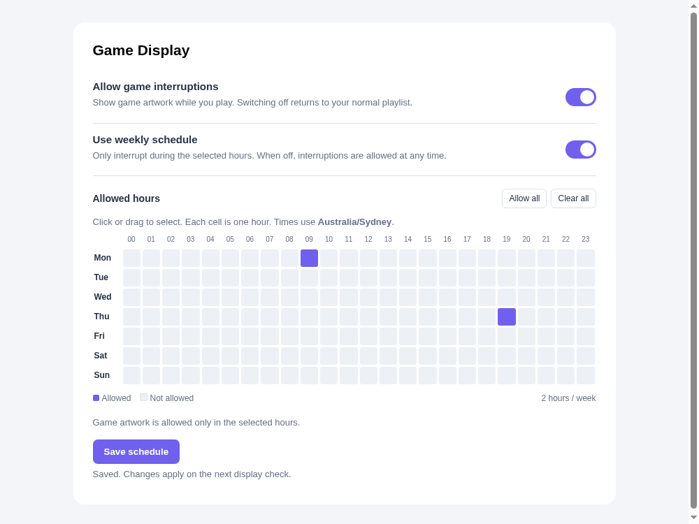

# Game Display for InkyPi

**v0.1.0 · GPL-3.0 · by JuiceSpin**

Show artwork for the game you are playing on your InkyPi display. Game artwork interrupts the normal playlist while you play, then returns to the current scheduled playlist or the previous image.

Supports Home Assistant's Gaming Status integration, with native Xbox titled hero artwork and PC hero images with a logo or title overlay. Includes an on/off switch and a compact weekly schedule.



## Quick setup

You need a working InkyPi installation with its **API Keys interface and plugin blueprint registration extension**, plus a Home Assistant Gaming Status master sensor that already detects your games. The installer checks compatibility before changing files; see [supported capabilities](docs/COMPATIBILITY.md).

1. Download and extract the **[v0.1.0 release](https://github.com/JuiceSpin/inkypi-game-display/releases/tag/v0.1.0)** on the Pi.
2. In the extracted directory, run:

   ```bash
   python3 scripts/install.py --check
   sudo python3 scripts/install.py
   ```

3. In **InkyPi → API Keys**, add `HOME_ASSISTANT_TOKEN` with a Home Assistant long-lived access token.
4. Open **Game Display → Connection & artwork settings**, set your **Home Assistant URL** and **Gaming Status master sensor**, and save.
5. Choose **Test saved connection**, then launch a game.

That is all the minimum setup needs. Do not add Game Display to a playlist: it runs automatically. Settings and API-key changes apply without restarting InkyPi.

[Step-by-step installation and first test →](docs/INSTALLATION.md)

## What it does

- Displays the current game's artwork and avoids refreshing unchanged images.
- Prefers Xbox's titled hero art and can retain it for the session.
- Composes PC hero art and a logo, with a text fallback for missing artwork.
- Returns to normal content when play ends, interruptions are disabled or an allowed schedule window closes.
- Supports click-and-drag hour selection across 24 hours × 7 days, in InkyPi's timezone.
- Provides optional raw PC, Steam and Xbox sensors for faster session-end detection.
- Handles source outages and restart recovery.
- Keeps credentials in InkyPi API Keys, with a connection test and masked key status.

## Options without a complicated first setup

Defaults are ready for a first test. Expand the optional groups only when needed:

| Group | Options |
| --- | --- |
| Interruption controls | Global switch, weekly schedule and 168 hourly cells. |
| Connection | HA URL and master player sensor. |
| Optional platforms | Xbox title/artwork, PC agent, Steam presence and Xbox in-game entities. |
| Timing | Polling, faster stop detection, stop confirmation, connection-loss timeout, artwork recheck and request timeout. |
| Artwork | Xbox preference/retention, logo/title overlays, fit or crop, and return behaviour. |
| Layout | Background/title colours, text size, padding, logo dimensions and position. |
| Advanced | Master sensor attribute names for title, platform, hero, logo and fallback cover. |

The [complete reference](docs/OPTIONS.md) explains every option, its default, accepted values and effect. Display resolution, orientation, image enhancement and timezone are inherited from InkyPi.

## Guides

- [Install, find entity IDs, configure Xbox, test, update and uninstall](docs/INSTALLATION.md)
- [Every option and default](docs/OPTIONS.md)
- [Compatibility](docs/COMPATIBILITY.md)
- [Troubleshooting](docs/TROUBLESHOOTING.md)
- [Changelog](CHANGELOG.md)
- [v0.1.0 release notes](releases/v0.1.0.md)
- [Development and reproducible releases](docs/DEVELOPMENT.md)

## Licence and credits

Copyright (C) 2026 JuiceSpin. Licensed under [GPL-3.0-only](LICENSE); see [NOTICE](NOTICE).

Built for [InkyPi](https://github.com/fatihak/InkyPi), using data from [Gaming Status](https://github.com/adamjthompson/Gaming-Status) and optionally [Gaming Status Agent](https://github.com/adamjthompson/Gaming-Status-Agent). This is an independent plugin. No game artwork, credentials or personal runtime configuration are included in the release.
